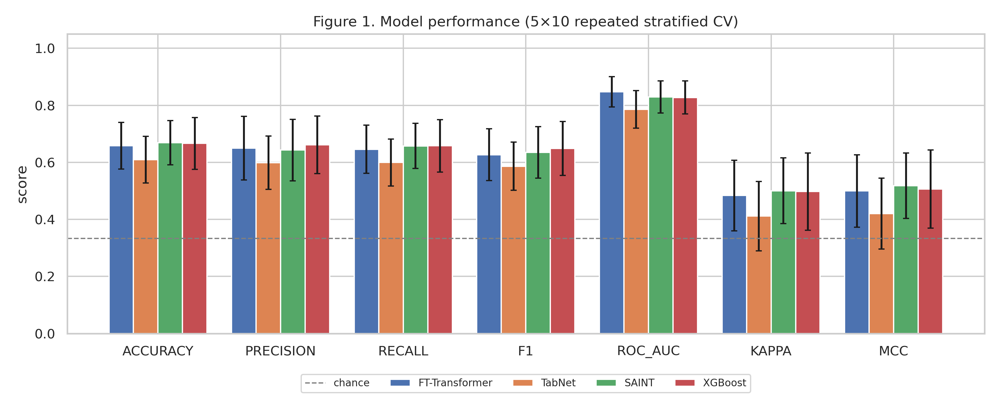
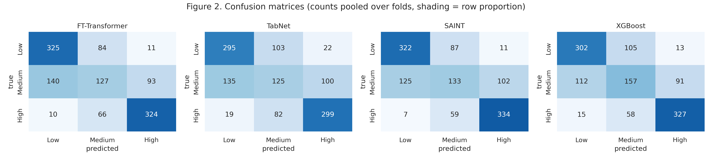
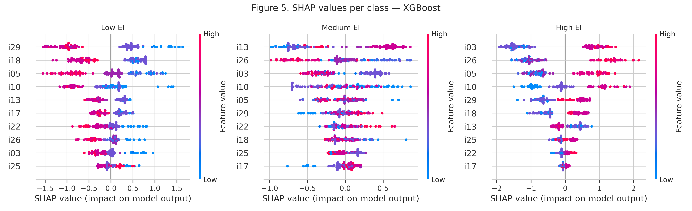

# Predicting Trait Emotional Intelligence from a Short Item Subset of the TEIQue-SF

Can a handful of questionnaire items recover a person's full-scale Emotional Intelligence (EI) classification? This project compares three deep tabular architectures against gradient boosting on 118 respondents' TEIQue-SF data, with SHAP-based interpretation and a psychometric analysis of why accuracy tops out where it does.

| | |
|---|---|
| **Data** | 118 respondents × 30 TEIQue-SF items (5-point Likert), Cronbach's α = 0.848 |
| **Task** | Classify Low / Medium / High EI (tertiles of the 30-item mean) from a 10-item subset |
| **Models** | XGBoost, FT-Transformer, SAINT, TabNet |
| **Evaluation** | 5-fold × 10-repeat stratified CV, corrected resampled t-tests with Holm correction |

## Key findings

**1. The obvious design is circular.** Predicting the EI class from all 30 items is target leakage, because the label is a tertile split of the mean of those same items. This repo therefore predicts the *full-scale* class from a *k = 10 item subset*, selected inside each training fold using corrected item-total correlation (which never sees the label). The all-30-item run is kept only as a labelled diagnostic ceiling. A label-shuffle permutation test confirms there is no leakage (real 0.683 vs. shuffled 0.331 accuracy).

**2. No model clearly beats the others.**

| Model | Accuracy | F1 | ROC-AUC | Params | Train (s) |
|---|---|---|---|---|---|
| SAINT | 0.669 ± 0.077 | 0.635 | 0.829 | 1,021,699 | 1.50 |
| XGBoost | 0.666 ± 0.090 | 0.649 | 0.828 | 9,127 | 0.12 |
| FT-Transformer | 0.658 ± 0.082 | 0.627 | 0.847 | 101,635 | 1.02 |
| TabNet | 0.609 ± 0.082 | 0.586 | 0.786 | 6,316 | 5.15 |

After the corrected repeated-CV test and Holm correction, **no pairwise difference is significant** (`results/table4_significance.csv`). XGBoost matches the deep models with ~100× fewer parameters.

**3. The ceiling comes from the instrument, not the models.** The Medium band is 0.30 scale points wide, which is narrower than the 95% CI of a single respondent's score (±0.31). Per-class recall confirms it: Low ≈ 0.70–0.79, **Medium ≈ 0.47–0.51**, High ≈ 0.74–0.79. Accuracy rises monotonically with distance from the nearest cut-point (0.36–0.56 right at a boundary, 0.90–0.93 for cases > 0.20 away), and only 5–10% of errors are severe Low↔High confusions. See [docs/METHODOLOGY.md](docs/METHODOLOGY.md) §3.

## Results at a glance

<p align="center">
  
  
</p>
<p align="center">
  
</p>

All tables and figures are in [`results/`](results/).

## Repository structure

```
.
├── 00_sanity_checks.py          # permutation test, learning curve, train/test gap, degenerate-prediction check
├── 01_clean_and_score.py        # clean raw export -> scored dataset with Low/Medium/High labels
├── 02_diagnostics.py            # demonstrates the circularity problem and the realistic short-form range
├── 03_significance_tests.py     # corrected resampled t-tests + Holm correction
├── 04_train_model.py            # train and save a single model (with per-epoch logs)
├── 05_psychometric_analysis.py  # reliability, SEM, band widths, boundary density
├── ei_pipeline.py               # main experiment: 4 models x 5x10 CV, tables, figures, SHAP
├── teique_clean.csv             # anonymised, scored dataset (used by all scripts)
├── teique_raw_numeric.csv       # anonymised numeric responses before reverse-keying
├── results/                     # tables (CSV) and figures (PNG) from the paper run
├── models/                      # trained weights, training logs, learning curves
├── docs/
│   ├── METHODOLOGY.md           # design rationale, data-quality handling, evaluation protocol
│   └── RUNBOOK.md               # step-by-step order of operations
└── requirements.txt
```

## Quick start

```bash
git clone https://github.com/riri6967/teique-ei-prediction.git
cd teique-ei-prediction
python -m venv .venv
source .venv/bin/activate        # Windows: .venv\Scripts\activate
pip install -r requirements.txt
```

Run the scripts from the repo root, in this order (details in [docs/RUNBOOK.md](docs/RUNBOOK.md)):

```bash
python 02_diagnostics.py                 # confirm the design is not circular
python 00_sanity_checks.py --model xgb   # permutation test: shuffled accuracy should be ~0.333
python ei_pipeline.py --no-torch         # fast check, sklearn/XGBoost only
python ei_pipeline.py                    # full run (15-40 min on CPU, ~10 min on GPU)
python 03_significance_tests.py          # statistical claims
python 05_psychometric_analysis.py       # measurement-resolution analysis
```

Deep models run much faster on a GPU, and [Google Colab](https://colab.research.google.com/) works well. Design and item count are set at the top of `ei_pipeline.py` (`DESIGN = "shortform"`, `K_ITEMS = 10`).

## Data and ethics

`teique_clean.csv` contains only anonymous respondent IDs and item responses. The original Google Forms export included optional names and timestamps and is **not** included in this repository. Some respondents selected multiple options on a single item; the handling of these cases (and of duplicate and straight-lining responses) is documented in [docs/METHODOLOGY.md](docs/METHODOLOGY.md) §2.

## Limitations

- Small sample (n = 118) from a convenience sample, so results may not generalise.
- The labels are relative tertiles of this sample, not clinical or normative categories.
- Scores are self-reported trait EI and not an ability-based measure.

## License

Released under the [MIT License](LICENSE).

## Citation

If you use this work, please cite it as:

```
Kumar, R. (2026). Predicting Trait Emotional Intelligence from a Short Item Subset of the TEIQue-SF.
GitHub repository: https://github.com/riri6967/teique-ei-prediction
```
